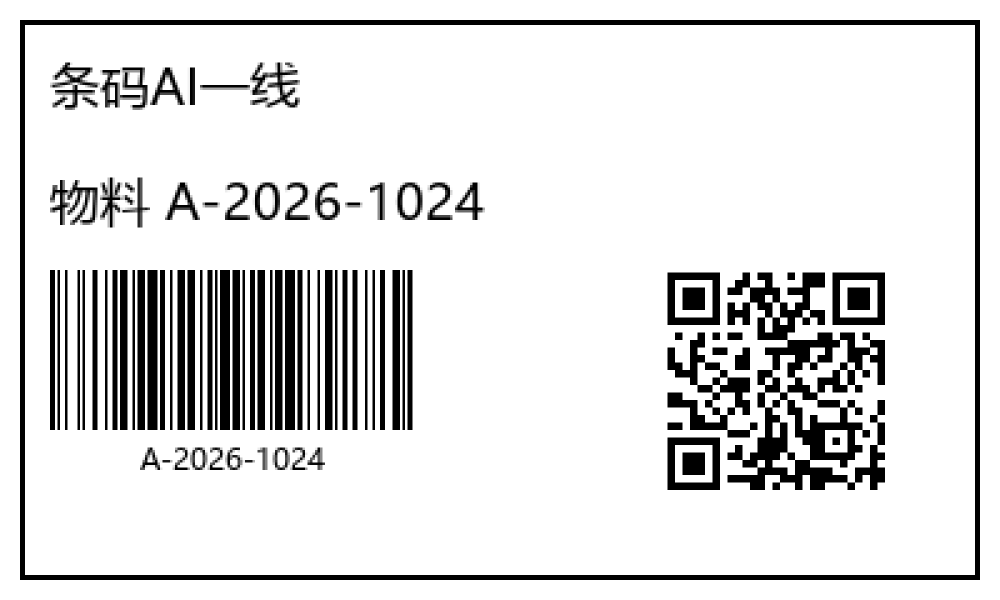

# zebra-printer-mcp

ZPL 标签生成 + Zebra Link-OS 打印机控制的 **stdio MCP 服务器**（Windows 实机跑通，Linux/macOS 除 `windows`/`usb` 传输外通用）。

> **技术交流完整版文档**：[`docs/MCP-技术交流文档.md`](docs/MCP-技术交流文档.md)（协议、ZPL 细节、踩坑清单）
>
> **AI 调用选型指南**：[`docs/MCP-AI调用指南.md`](docs/MCP-AI调用指南.md)（为什么适合 AI 用、怎么用、**什么场景不该用**）
> （架构图、9 工具详解、label spec 全键表、ZR668 实机数据、中文打印配方、stdio 探针纪律、离线渲染预览、20 条踩坑清单）

知识底座：ZPL II Programming Guide（Zebra 官方 PDF，本机全文抽取）+ Link-OS 文档 <https://techdocs.zebra.com/link-os/latest/> 。实机验证：Zebra ZR668-200dpi（固件 V86.20.21Z）— 网络打印、状态查询、中文打印全部跑通。

## 快速开始

```bash
git clone https://github.com/benyshen/zebra-printer-mcp.git
cd zebra-printer-mcp
uv venv .venv --python 3.12      # 或 python -m venv .venv
# Windows:
.venv\Scripts\pip install -e .
# Linux/macOS:
.venv/bin/pip install -e .

# 自检（不需要打印机）
.venv/bin/python tests/test_builder.py    # → ALL TESTS PASSED
.venv/bin/python scripts/mcp_probe.py     # raw JSON-RPC 探针，列出 9 工具
```

> **必须 `mcp<2`**：2.x 移除了 `mcp.server.fastmcp`，pyproject 已钉 `mcp>=1.9,<2`。

## 9 个 MCP 工具

| 工具 | 作用 |
|---|---|
| `generate_zpl` | JSON label spec → ZPL II（mm 坐标自动换算 dot；内置手册默认值/范围校验，返回 issues） |
| `validate_zpl` | 用手册解析出的命令目录校验任意 ZPL |
| `zpl_knowledge` | 查命令语法/默认值/页码、SGD 命令、`~HS` 状态码、条码制式目录 |
| `render_zpl` | 把 ZPL 渲染成 PNG，离线看图再决定要不要打 |
| `list_printers` | 枚举 Windows 打印队列（找 Zebra 队列） |
| `send_zpl` | 发送：`tcp`(9100 raw) / `windows`(假脱机) / `usb` / `preview`；`dry_run` 只校验+预览 |
| `printer_status` | 查询打印机状态：Link-OS SGD 优先，老固件自动回退原生 `~HI`/`~HS` |
| `print_xlsx` | 读 `.xlsx` 两列（姓名 + 员工号），一行一张标签、文本与 128 码各自居中，整批一个 ZPL 流 |
| `zpl_from_image` | 一张现有标签的照片 → 解码条码/二维码 + OCR 文字 + 像素换算 dot → ZPL；可 dry_run 或直发 |

## 看得到再打：`render_zpl`（离线渲染预览）

校验器管语法，管不了"字压到条码上了"。`render_zpl` 把 ZPL 画成 PNG，纯本地，约 50 ms：

```bash
pip install -e ".[render]"          # pillow + segno + python-barcode，三个纯 Python 依赖
```

```json
{"zpl": "^XA^PW400^LL240…^XZ", "scale": 3}
```

返回 `{ok, png, dots:[400,240], drawn[], approximated[], warnings[]}`；`drawn[]` 里每个元素带 dot 边界，可以直接和 spec 坐标对账。



**保真度**（同一段 ZPL 与 Zebra 自己的渲染逐值对照）：`^A0N,43` 的 `NANJING` 本工具 156×33 dots / 真机 153×34；Code128 101 模块 × `^BY3` = 303 dots、起于 x=30，与真机完全一致；QR 21 模块、模块宽 = `^BQ` 的 c，位置也一致；`^GB`/`^GC` 精确。

**故意不做的**：DataMatrix / PDF417 / Aztec / MaxiCode 等没有离线编码器，只画占位框并在 `approximated[]` 里点名；打印机内置字体用 host 字体近似；`^FR` 反白按正常黑画。**它是版式预览，不是 ZPL 仿真器**——能告诉你"会重叠 / 会出界 / 会溢出"，不能告诉你"能不能扫"。

## label spec 示例（generate_zpl 入参）

```json
{
  "dpi": 200, "width_mm": 70, "height_mm": 30, "quantity": 2, "darkness": 10,
  "fields": [
    {"type": "text", "data": "条码AI一线", "x_mm": 2, "y_mm": 2, "size_mm": 3.5,
     "font_file": "E:SIMSUN.TTF"},
    {"type": "barcode", "symbology": "code128", "data": "ABC12345",
     "x_mm": 2, "y_mm": 9, "height_mm": 12, "interpret": true},
    {"type": "barcode", "symbology": "qrcode", "data": "https://example.com",
     "x_mm": 45, "y_mm": 9, "scale": 4},
    {"type": "box", "x_mm": 1, "y_mm": 1, "width_mm": 68, "height_mm": 28}
  ]
}
```

坐标默认 mm（`x_mm/y_mm`），也可给 `x_dots/y_dots`。条码制式 28 种：code128/code39/code93/code11/
i2of5/industrial2of5/upca/upce/ean13/pdf417/micropdf417/datamatrix/qrcode/aztec/codabar/msi/code49/codablock/
gs1databar/upsmaxicode…（见 `zpl_knowledge mode=barcodes`）。

二维码的 `^FD` 会自动加手册要求的前缀（`^FDQA,` = 纠错级 Q + 自动输入模式）；漏掉前缀打印机会
把数据前两个字符当开关吃掉，实测会把 `https://…` 编成 `ps://…`。

## 表格批量：给一个 .xlsx，一行一张标签

```text
print_xlsx(xlsx_path="D:/名单.xlsx", name_column="姓名", id_column="员工号",
           width_mm=50, height_mm=30, dry_run=False, host="<打印机IP>")
```

- 列可写成 Excel 字母（`"A"`/`"B"`）、1 基序号（`1`/`2`）或表头文字（`"员工号"`）；首行当表头。
- 姓名用 `^FB …,C` 由打印机居中；工号打 Code128 并按 `11×(n+2)+13` 个模块算宽度居中（`^BC` 没有对齐参数）。
- 整批拼成**一个 ZPL 流、一次 TCP 连接**：打印机回显只读一次（5 张 ≈1.0 s，不是 5 s）。
- 只支持 `.xlsx/.xlsm`（标准库解 zip，无 openpyxl 依赖）；`.xls` 请先另存。
- 命令行孪生：`python scripts/xlsx_labels.py 名单.xlsx --name 姓名 --id 员工号 [--execute --host <IP>]`

## 照片 → ZPL：拍一张现有标签，重建出能打的 ZPL

```text
zpl_from_image(image_path="D:/标签照片.png", width_mm=60, height_mm=40,
               frame="auto", dry_run=True)          # dry_run=False + host= 直发
```

链路全在本仓库里（`photo.py` + `ocr.py`），不依赖外部工程：

1. `frame="auto"`：找标签四边形并做透视校正（Otsu + 轮廓，双极性各试一次）；找不到就退回整图（`frame="full"` 表示照片已经裁好）。
2. 解码：zxing-cpp 读所有一维码/二维码，拿到 `format` 和原文。
3. 读字：PP-OCRv4 det+rec（ONNX）；**落在一维码正下方的文字条按位置合并成 HRI**——OCR 会把 `ABC123` 读成 `ABC1Z3`，按字面比对失败就会把这一行打印两遍。
4. 换算：`dots = px × 标签宽(dot) / 照片宽(px)`；一维码按码制模块数反推模块宽（Code128 = `11×n+13` 个模块），二维码反推放大倍数；文字按 `size ≈ 框高 / 0.775`。
5. 输出 label spec 交给同一个 `builder`，所以校验、`^BY` 模块宽、中文 `^A@…E:SIMSUN.TTF` 规则全部复用。

实测（样例图 480×320 px，60×40 mm / 203 dpi）：Code128 `^FO30,21`、二维码 `^FO379,24`、文字 `^FO296,231`，与已有参考实现的像素测量**逐值一致**；把生成的 ZPL 送 Labelary 渲染再用 zxing 解码，`ABC123` 与 `NGSU` 原样读回。

用大模型认字（可选，需给端点）：

本机没装 OCR 权重、或字被设计得 PP-OCRv4 认不出时，让视觉大模型来读。接口按 OpenAI
`/chat/completions` 兼容格式，vLLM / ollama / LM Studio / DashScope / 通义 / Moonshot / 本地 Strata 都能接。

两种给法，**key 都不落盘、不进仓库、不回显**：

```text
# 1) 单次调用直接传（客户端能安全持有 key 时）
zpl_from_image(image_path="D:/标签.png", width_mm=60, height_mm=40,
               llm_url="http://192.168.1.50:8000/v1", llm_key="<你的key>",
               llm_model="qwen2.5-vl-7b-instruct")
```

```json
// 2) 注册时写进环境变量，之后调用不必再传
{
  "mcpServers": {
    "zebra-printer": {
      "command": "<repo路径>/.venv/Scripts/python.exe",
      "args": ["-m", "zebra_mcp.server"],
      "cwd": "<repo路径>",
      "env": {
        "ZEBRA_VISION_URL": "http://192.168.1.50:8000/v1",
        "ZEBRA_VISION_KEY": "<你的key>",
        "ZEBRA_VISION_MODEL": "qwen2.5-vl-7b-instruct"
      }
    }
  }
}
```

Hermes 侧同理，把 `env` 放进
`hermes config set mcp_servers.zebra-printer '{...,"env":{"ZEBRA_VISION_URL":"...","ZEBRA_VISION_KEY":"..."}}'`。
`llm_url` 可以只写到 `/v1`，模块自己补 `/chat/completions`；`llm_model` 省略时默认
`qwen2.5-vl-7b-instruct`——**多数端点必须显式给自己的模型名**。

分工与边界：

- **条码内容永远以 zxing 解码为准**。模型报的条码值只作提示：zxing 一张都没解出来时才用它兜底，
  并且返回里标 `unverified: true` + `BARCODE_UNVERIFIED` 警告——模型读错一位数字的概率不低，打一张扫一张。
- 模型的文字框是 0–1 归一化坐标，像素→dot 仍在 `photo.py` 里算，可复核。
- 失败会明确分类：`HTTP 401 → check llm_key`、`404 → check llm_url`、`429 → rate limited`、`URLError → cannot reach`；
  报错文本会把 key 和响应体都截断+替换，不会漏进返回值。
- 识图要花钱/要时间：一张标签 ≈ 1 次多模态调用（几百 token + 一张图）。本地 OCR 是 0.14 s 的免费路径，
  能用就别走网络。

安装与模型：

```bash
.venv\Scripts\pip install -e ".[photo]"    # opencv/zxing-cpp/onnxruntime/pyclipper
# 模型（15 MB）不入库，二选一：
#   set ZEBRA_OCR_MODELS=D:\models\paddleocr
#   或把 ch_PP-OCRv4_det_infer.onnx / ch_PP-OCRv4_rec_infer.onnx / ppocr_keys_v1.txt 放进 data/ocr/
```

边界（写清楚，别指望它做到）：

- **是重建，不是设计**：只还原位置、码内容、文字尺寸；字体认不出（一律 `^A0`/`E:SIMSUN.TTF`）、线条/logo/图片一律不转（不生成 `~DG`/`^GF`）。
- 小字 OCR 会错：154 px 宽的 `NANJING` 在 15 px 高时被读成 `NAN-ING`（置信度 0.87）。**打之前看一遍 `elements`**，错一个字就改 `text` 重发。
- 没有 `width_mm`/`height_mm` 就没有比例尺：给错尺寸等于整体缩放，`ASPECT` 警告只在你给错太离谱时才会响。
- 照片糊、倾斜 >45°、条码被压扁/反光 → 解码直接空手而归，此时它不会编造条码内容，只会返回 `symbol_count: 0`。
- 二维码在照片里太小（<21 px 见方）时 zxing 读不出；先把照片拍清楚比调参数有用。

**尺寸对不上先查纸**：`paper_mm` / `paper_height_mm` 是照片里**纸张**的尺寸，可以大于 `width_mm`/`height_mm`（印刷区）。模切标签常见 76×70 的纸承载 70×70 的图案，只报印刷区会让整幅小 8%。纸非正方形时两个值都要给，否则横向被压。实测这套参数能把条码还原到 285 dots（与原张一致）、表格框还原到 533×404（设计值 527×400）。位置差 1–2 mm 用 `offset_x_mm`/`offset_y_mm` 平移，别改尺寸。

**已知缺口**：重建符号与文字，**不重建表格线**（外框/分隔线要自己补 `^GB`）。照片里的线条倾斜 1–3°，横向核会切碎、Hough 又会把纸边和条码外框当成表格线，实测假线比真线多，所以宁可不猜。OCR 噪点（高度 < 10 dots，`^A` 的下限）会被丢弃并记 `OCR_DROPPED`。

## 中文打印（ZR668 实机验证）

ZR668-200dpi 内置中文 TrueType：`E:SIMSUN.TTF`（宋体）、`E:HANS.TTF`（思源黑）——打印机 web 后台 `/dir?dev=E:&otype=.TTF` 可列目录。配方：

- 中文字段加 `"font_file": "E:SIMSUN.TTF"` → 生成 `^A@N,高,,E:SIMSUN.TTF`；含中文自动 `^CI28`
- transport 对 `^CI28` + 非 ASCII 自动按 **UTF-8 字节**发送（cp1252 会把中文变 `?`）
- 已实测：宋体/思源黑两行 `^CI28` UTF-8 中文 + Code128 经 MCP `generate_zpl` → `send_zpl(tcp)` 打印成功

## MCP 客户端注册

### Hermes

```bash
hermes config set mcp_servers.zebra-printer '{"command":"<repo路径>/.venv/Scripts/python.exe","args":["-m","zebra_mcp.server"],"cwd":"<repo路径>","connect_timeout":30.0,"enabled":true}'
hermes mcp test zebra-printer   # ✓ Connected, 8 tools discovered
```

（JSON 里用**正斜杠**路径——`\\w` 这类反斜杠会被转义吃掉。）

### Claude Desktop / 其它 stdio 客户端

```json
{
  "mcpServers": {
    "zebra-printer": {
      "command": "<repo路径>/.venv/Scripts/python.exe",
      "args": ["-m", "zebra_mcp.server"],
      "cwd": "<repo路径>"
    }
  }
}
```

Linux/macOS 把 `command` 换成 `.venv/bin/python`。

## 接上物理 Zebra 打印机

1. 网络打印机：`printer_status host=<IP>` 先探活 → `send_zpl transport_kind=tcp host=<IP>`。
2. USB/驱动打印机：`list_printers` 找队列名 → `send_zpl transport_kind=windows printer=<队列名>`。
   走的是一条 raw 通道（winspool `WritePrinter` + `datatype=RAW`），驱动不参与渲染；
   返回 `job_id` / `bytes_sent` 便于核对。虚拟打印机（PDF/OneNote 之类）会"假成功"，用 tcp 更稳。
3. SGD 调参：`printer_status sgd=device.ip.address`、`sgd=do:calibration` 等；老 Fusion 固件
   （如 ZR668 V86）SGD 不可用，工具自动回退 `~HI`/`~HS`，返回 `status` 状态字解析结果。
4. 无打印机时可先用 `transport_kind=preview`（写 `%TEMP%\zebra-mcp\label_preview.zpl`，
   可在 <https://www.labelary.com> 渲染核对）。

## data/ 恢复表（不入库的文件）

仓库提交 `data/command_catalog.txt`（命令目录，运行时必需）。以下是从 Zebra 版权手册 PDF
派生的大文件，**不提交**；需要时用自己的 PDF 副本重建：

| 文件 | 作用 | 恢复方法 |
|---|---|---|
| `data/zpl_manual_full.txt` | 手册全文（页锚 `<<<PAGE n>>>`） | `pip install pypdf` → `python scripts/extract_manual.py <你的 zpl-zbi2-pg-en PDF>` |
| `data/zpl_command_secs.txt` | 手册命令章节索引 | 同上脚本一并生成 |
| `data/zpl_params_notes.txt` | 命令参数/Format-line 笔记 | 同上脚本一并生成 |

PDF 来源：Zebra 官网 ZPL II Programming Guide（<https://www.zebra.com/zpl>）。

## License

MIT
